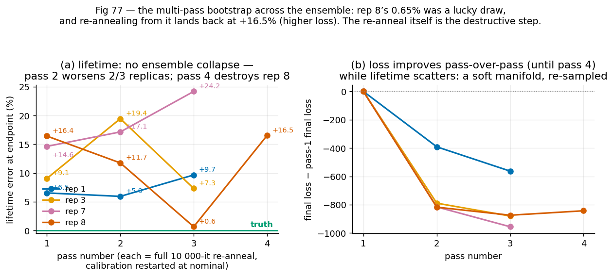
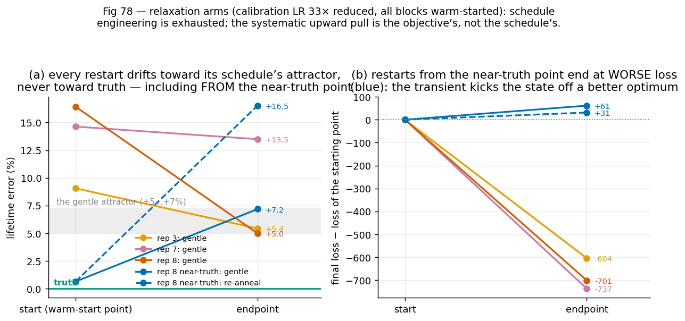

# Optimizing the fit: global summary of findings

One entry per study: what was tested → key numbers → verdict. Figures inline. Full detail lives in
`NOISE_CAMPAIGN_REPORT.md` (§6w) and `NOISE_CAMPAIGN_DIGEST.md`; corrections are marked ⚠.

**The one-paragraph version.** Schedule tuning (annealing) was the single biggest optimizer win
and is converged; warm-start recipes (TS1) buy real position/loss gains cheaply. Every diagnostic
says the objective itself is sound — truth beats every fit, the fit→truth path is monotone
downhill — so the residual error is *reachability*: the optimizer lands short, and where it lands
has a **systematic +8.6% upward lifetime bias** driven by transients along a soft
lifetime↔dE/dx↔geometry manifold. Second-order methods lose to Adam everywhere except as
curvature *instruments* (error bars). All schedule-side fixes are now measured and exhausted;
the open front is the objective's coupling (scale/shape reparametrisation under test) and
independent drift-axis information.

---

## 1. Schedules and learning rates

**The S4 graveyard (figs 2–3)** — ~a dozen strategies (drift penalties, stiffer priors, geometry
freezes, two-pass fits), 3–6 seeds each: all failed. The unannealed baseline performs a biased
random walk that *crosses* truth, producing false positives (one config read −3.8% at 5 000 it and
+38 ± 26% at 8 000). Verdict: **endpoint reads of unconverged random walks can return anything.**

**ANNEAL — the campaign's single biggest fix (figs 7, 16)** — Calibration LR decay 0.999 → 0.91
(else 95.7% of peak LR remains at run end). Lifetime **+62.7 ± 49.5% → −2.1 ± 4.5%**, position
519 → 255 µm. Verdict: **anneal the parameters of interest while the nuisances keep adapting.**

**ANNEALLONG / SLOWANNEAL — schedule invariance (fig 20)** — 10 000 it beats 5 000 at 2× compute;
but matching final LR while raising total travel 1.78× moves lifetime −2.0 → −5.0% while the other
four parameters stay put. Verdict: **four parameters sit in a genuine attractor; lifetime is
schedule-dependent — quote it as a bound.** (Directly visible in the production traces, fig 43:
lifetime never flattens.)

**Block-schedule sweep (fig 49)** — Cooling the dE/dx LR ×0.01 helps lifetime on high-lever-arm
seeds (−2.75 ± 0.51, 4/4) by stopping co-adaptation, hurts starved seeds; calibration decay 0.80
freezes fits mid-flight, 0.97 never converges. Verdict: **keep decay 0.91 — it sits between two
failure modes; nuisance cooling is real but seed-dependent.**

**Geometry LR screen (fig 57)** — Raising the geometry LR (×3, ×10) is worse or divergent;
*sustaining* it (slower decay) is −8.1% better on position. Verdict: **sustain the nuisance rate,
never raise it** — independently validates the G20K design.

**The epoch-indexing trap (NB400)** — Decay is indexed in epochs = `len(dataloader)`: raising
`max_nbatch` 4× silently left the calibration LR 1 250× higher at readout (lifetime +52%,
position 3 545 µm). Verdict: **not a physics result — changing data volume changes the schedule
unless the decay is recompensated.** (Related: the calibration peak LR itself was hard-coded 1e-1
in the launcher for the entire campaign — only its decay was ever tuned; found Sep 2026.)

## 2. Warm starts and block strategies

**dE/dx ablation (`CONSTDEDX`, fig 23)** — Freezing the ~4 000 dE/dx nuisances at the mean:
long. diffusion ×4 worse, lifetime ×2.7 worse, geometry unchanged. Verdict: **the nuisance block
does real work; removing it is a one-sided trade.**

**Block alternation (`ALT`/`ALTW`, fig 62)** — ⚠ The "×2.3 A_b gain" from a frozen-geometry
second pass was **retracted**: the 3 000-it arms were read at 700× higher LR than the baseline —
nothing descended, the arms wander a flat region. Verdict: **arms must be compared at equal
schedule phase (compress the decay), and block alternation bought nothing when tested properly.**

**The block matrix (`BM*`, figs 63–65)** — All 7 freeze-combinations warm-started from the
baseline, equal-phase schedules. Freezing **calibration** is the one big lever (loss −3.25%,
position 165 → 116 µm, helps both nuisance blocks); freezing geometry erases the descent. And the
poison pill: the best-loss arms are the worst lifetime degradations (+3.5 pts, both seeds).
Verdict: **freeze calibration to improve the fit — but selecting on loss selects *against*
lifetime accuracy.**

**G20K — stretch both schedules (fig 61)** — Both decays stretched ½ in the exponent over
20 000 it: position −57 µm (3/3), loss −8.7%, reaches the baseline's endpoint at iteration 7 422.
Verdict: **a genuinely better optimum, at 2× cost (26.4 h).**

**TS1 / TS2 — the production recipe (figs 67–68)** — Stage 1 (freeze calibration, re-anneal
warm-started nuisances 10 000 it): position 105 µm, beats G20K's loss 3/3 at **51% of the
compute** (13.5 h), confirmed n = 6/6. Stage 2 (release calibration) is an honest null — wins
loss, loses transverse diffusion. ⚠ The 4 000-it shortcut is NOT free (+10 µm, +378 loss, 3/3).
Verdict: **adopt TS1 at 10 000 iterations; stage 2 optional. Note it is a better *fit*, not a
better *calibration* — its calibration is the baseline's, frozen.**

**Spline basis truncation (`K2`, fig 60)** — Dropping spline mode 3: −2.5% position, 10% cheaper;
mode 3 was recovered at −62% error anyway. Verdict: **adopt for compute, not accuracy** — and its
figure documents the trap: a 3 000-it screen can rank position but never calibration (the baseline
was mid-transient).

**Data volume, done right (figs 33, 38, 42)** — More data with the schedule recompensated
(`NB400FIX`, `nb200`) buys calibration precision (spread ×1.7 tighter) but starves geometry unless
compute scales too; batch shuffling is a verified null; and GPU non-determinism alone gives a
2.2-point lifetime floor at fixed seed (three identical runs: −4.3, −8.3, −2.0%). Verdict:
**scale iterations with data; n = 3 cannot resolve ~4-point effects; seed count cannot beat the
non-determinism floor.**

## 3. Landscape diagnostics: is it the objective or the optimizer?

**Hessian at truth + 2-D scan (figs 5, 12)** — The loss minimum sits exactly on truth; the softest
mode is a mixed (lifetime, long. diffusion) plane ~2 400× flatter than A_b, ~4×10⁶ flatter than
E field. Verdict: **the objective is unbiased — every failure is navigation along a nearly flat
valley.** (Caveat from the GN work: the Hessian is *indefinite* away from truth, so truth-point
curvature does not describe where the optimizer operates.)

**Dynamic-mode PCA (fig 13)** — The direction actually travelled overlaps the predicted soft plane
at 0.93 with annealing vs 0.74 without. Verdict: **annealing puts the optimizer back into the
subspace the static analysis predicts — mechanistic confirmation of the ANNEAL fix.**

**1-D likelihood scans + the quality ladder (figs 26–30)** — Scans through truth at degraded
inputs: dE/dx fidelity is a **bias** channel (lifetime +2.2 → +7.0% along the ladder), position
error is a **variance** channel (long. diff. error 4 → 41 points). The fine grid shrank the
true-geometry objective displacement to ≤ ~1%. Verdict: **the objective at good inputs is
essentially unbiased; input quality maps onto distinct error modes.**

**Slice vs profile (fig 40)** — 2-D (lifetime, A_b) scans: the guess-geometry "+13.9% lifetime
bias" collapses to **+0.4%** once A_b is profiled (factor 32). Verdict: **1-D slices manufacture
fake lifetime sensitivity whenever a charge-normalisation error exists; only profiles count.**

**Truth-point evaluation (figs 46–47)** — Moving single blocks to truth at the fit: geometry
−213 NLL (genuinely unreached — optimizer problem), dE/dx +568 driven entirely by its student-t
prior (objective problem), calibration +18 (already at its likelihood optimum). Verdict: **each
block fails differently: geometry = reachability, dE/dx = prior displacement, calibration =
done.**

**α-scans of the nuisance blocks (figs 52, 56)** — The likelihood wants ~66% of the true dE/dx
spread (no weight of the current prior reaches it); geometry carries 5× the likelihood range of
the dE/dx question and 228× longitudinal diffusion's. Verdict: **geometry dominates the
information budget and is purely optimizer-limited; the dE/dx prior is the one measured objective
defect.**

**Degeneracy matrix (fig 58)** — Every calibration parameter scanned at all 4 (geometry, dE/dx) ∈
{fit, truth} combinations: A_b and E field decouple from both nuisances; geometry dominates every
other coupling; degeneracies are additive. Verdict: **the map of which parameter is hostage to
which block** (its "4–16× from floor" reading was later superseded by HESS: 3.3–71×).

**LSCAN (fig 66)** — ⚠ First published with the wrong conclusion (read a conditional minimum as
joint). Corrected: truth beats the fit 7/7 by 5.6%; single blocks moved alone make it *worse*
(geometry alone −7.0%, calibration alone +0.2%, dE/dx alone +2.8%). Verdict: **the lifetime error
is reachability, not the objective — and single-block scans cannot answer joint questions.**

**FP — the fit→truth line (fig 69)** — Loss along the joint line with all three blocks moving:
monotone downhill in every arm/seed, minimum AT truth, runs end at 8×10⁻⁵ of peak LR. TS1 closes
86–87% of the baseline's gap. Verdict: **no barrier — the fits stop from step-size exhaustion in
an ill-conditioned valley; the actionable ask is a preconditioner, not more first-order
iterations.**

**Drift-axis penalty (fig 14)** — Penalising the drift component of geometry (the suspected
lifetime contaminant): works as designed (drift fraction 58% → 1%) yet every physics number
worsens, position ×2.5 worse. Verdict: **refuted — the drift displacement is legitimate track
structure.**

## 4. Curvature as an instrument: real error bars

**Profile-by-refitting fails (fig 70)** — The expected lifetime signal across a ±10% grid is
7.5 nats/batch; the scatter between re-fits is 41.4 — **2 105× too noisy**, unfixable by
averaging. Verdict: **the noise is the optimizer's landing point, not the data; uncertainties
must come from curvature at the fitted point.**

**HESS — the 5×5 calibration covariance (fig 71)** — FD-of-gradient Hessian, validated against an
independent scan to 1–2% (and it exposed the old E field floor as 7× too large — measured outside
the quadratic region). Key number: **A_b↔lifetime correlation −0.71**; honest lifetime 1σ = 0.43%,
not 0.26%. Verdict: **the first real error bars, and the quantified central degeneracy.**

**SCH — exact dE/dx marginalisation (fig 72)** — The dE/dx block Schur-complemented exactly via
its banded+rank-1 structure (after three failed AD routes: 129 GB, 8.3 GB/tangent, FD-CG
divergence). The lifetime ladder: 0.30% (conditional) → 0.58% (calib correlations) →
**0.9–1.1%** (dE/dx-marginalised) vs 1.65% achieved; A_b↔lifetime deepens to −0.83. Verdict:
**lifetime is ×1.5–1.8 from its statistical floor, not ×6 — the frontier is the degeneracy, not
the optimizer.** (Geometry is still unmarginalised; floors are lower bounds.)

## 5. Second-order optimizers: tried, measured, retired

**GN from scratch (calibration)** — Tested: exact-Hessian / GGN Levenberg-Marquardt as the
calibration optimizer. Numbers: from-scratch runs garden-path into the degenerate corner (lifetime
pinned at bound, endpoints +148…+464 430%); the exact Hessian is *indefinite at nearly every
iterate* (eig −2.5 at a 1% offset, LM step at cos = −0.45 to the GGN step). Verdict: **rejected
from scratch — the curved degenerate valley rides saddles; truth-point curvature does not
extrapolate to where the optimizer operates.**

**GN as a polisher** — Tested: 2–3 damped LM-GN steps warm-started from an Adam endpoint.
Numbers: converges quadratically in ~13 iterations, improves Adam's endpoint (lifetime
−6.8 → +3.0%, eField → 0.00%), and yields the 5×5 covariance for free. Verdict: **the one GN role
that survives — final polish + error bars, never the driver.**

**Adam vs GN head-to-head (like-for-like)** — Tested: same batch, same loss. Numbers: a GN
iteration costs ~17× an Adam iteration and buys only ~8× fewer; Adam wins wall-clock 2.1× at 1%
offset; GN wins only where Adam stalls (5% offset). Toy caveat: the toy's minimum is displaced by
target noise — the best GN arm went *below* the truth loss while landing 14% wrong on lifetime.
Verdict: **GN buys robustness, not speed, and "closer to truth" is not what a better optimizer
delivers on a noisy objective.**

**GGN/Fisher approximation** — Tested: cheaper GGN curvature vs exact. Numbers: 2.8× cheaper/iter
but 2.7× more iterations (a wash); fails to converge at 5% offset; Frobenius mismatch to exact
1.75–4.9×, growing with batch count. Verdict: **exact beats GGN, and Fisher is too inaccurate to
even source a preconditioner.**

**Banded dE/dx Newton** — Tested: the dE/dx Hessian is exactly banded(2)+diagonal+rank-1 (mean
constraint), giving an O(N) direct Newton via 5 HVP probes + Sherman-Morrison. Numbers: validated
to 2.5e-6; at equal wall-clock it **ties Adam** at both κ ≈ 750 and κ ≈ 24 000 (Δloss −1.4 ± 6.9
and −2.1 ± 3.8); Adam's dE/dx MAE degrades +62% along its own trajectory. Verdict: **correct,
validated, not worth deploying — the dE/dx block is objective-limited, not optimizer-limited.**

**Spline-basis GN geometry** — Tested: matrix-free GGN/CG on the spline chain basis with
data-as-args shared jit. Numbers: per-batch 7 min → ~35 s (the wall was compilation, ~99%);
reaches 56 µm from 1051 µm in ONE epoch at 50 cm. But at production: ~400× Adam's per-iteration
cost (projected ~13 h vs 50 min), and 1 600 s/iteration at 400 cm after the memory fix. Verdict:
**an engineering success and a production dead end — per-batch GN fits that batch's noise while
Adam averages over seeds; stochastic averaging wins on a noisy objective.**

**L-BFGS geometry** — Tested: `--geom_optimizer lbfgs` in the joint fit. Numbers: ~170–190 s
fresh compile *per batch*, flat in array size (geometry batches don't bucket); OOM-killed at 1%
progress; no convergence evidence in the only run that executed. Verdict: **not viable —
engineering and science both unproven.**

**GN memory scaling** — Tested: peak GPU memory vs batch count and size. Numbers: batch COUNT is
free (sequential walk, 0.03% spread); batch SIZE binds at ~70 MiB/cm → 400 cm fits a 40 GiB A100,
never an 11 GiB card. Verdict: **scale data by batch count, not batch size.**

## 6. The landing bias: discovery, mechanism, and the death of schedule fixes

**`data_seed` replicas (fig 73)** — Tested: the same fit on 8 independent track samples at pinned
truth, after discovering `data_seed` had been a silent no-op campaign-wide (IO pre-trim ran before
event selection — every previous fit shared ONE track sample). Numbers: lifetime **+8.6 ± 1.6%**
mean bias, all 8 replicas above truth; the historical sample sits at the 2.6σ favourable tail; the
famous A_b "+0.27% bias" evaporates (+0.06 ± 0.04). ⚠ Verdict: **the procedure has a real, upward
lifetime landing bias; sample-composition scatter (4.5%) dominates the budget; the campaign's
sample was lucky.**

**Truth-point repair test (`TPREP`, fig 75)** — Tested: evaluate the loss with each block moved to
truth, singly and jointly, at the biased replicas' endpoints. Numbers: truth beats the fit on
biased replicas by 9–10%; single blocks moved alone make it *worse*; joint paths are monotone.
Verdict: **the objective prefers truth even on biased replicas — the bias is the landing point,
not the minimum.**

**Mechanism (`hot8`/`late8`/`gtru8`/`dw*`/`pass2r8`, fig 76)** — Tested: five interventions on the
worst replica (+16.4%). Numbers: geometry-init-at-truth → **+5.8%** lifetime, position 117 µm,
best loss by 870; calibration gate → catastrophic +55%; slower anneal → +14.6% (marginal); drift
penalty → +10.4% but degrades loss; truth-free warm-start pass 2 → +11.7%. Verdict: **one cause,
three symptoms — a hot-phase overshoot while geometry is near its bad init, relaxing too slowly
for the anneal; good geometry fixes lifetime, long. diffusion and position simultaneously.**

**Iterated truth-free bootstrap (`PASS2-4`, fig 77)** — Tested: re-anneal calibration from nominal
against the previous pass's nuisances, iterated; confirmation on 3 more replicas + a 4th pass on
rep 8. Numbers: rep 8 ladder 16.4 → 11.7 → **0.65%** — but ensemble mean **11.7 → 13.6 → 13.7%**
(pass 2 worsens 2/3 replicas), and pass 4 from the +0.65% point lands at **+16.5%** at *worse*
loss (8 324 vs 8 293). ⚠ Verdict: **retracted — each re-anneal re-runs the overshoot and re-draws
from a ±8%-wide upward-biased landing distribution; the 0.65% was its lucky tail.**

**Gentle relaxation (`RLX*`, fig 78)** — Tested: warm-start ALL blocks (calibration included) and
re-optimize with calibration LR 33× reduced — pure relaxation, no overshoot. Numbers: starts at
+0.65/+9.1/+16.4% all land at **+5…+7%** (a schedule-specific attractor; rep 7 lags at +13.5);
restarts from the near-truth point end at *worse loss* than their start (gentle +61, violent +31
nats); 10/10 restarts drift **up**, never down. Verdict: **schedule engineering is exhausted — any
optimizer-state restart drifts upward along the soft manifold; the pull is the objective's, not
the schedule's.** (Also found here: the launcher had calibration LR hard-coded at 1e-1 for the
whole campaign — only its decay was ever tuned; `SCILR` knob added.)

## 7. Methodology traps (each cost real time)

- **80% of runs were still moving when read out** (plateau audit, fig 4): the reported value can
  shift by up to 70 points between endpoint and plateau. Converge the arm or quote its
  oscillation.

- **Epoch-indexed LR decay**: raising `max_nbatch` silently un-anneals the calibration LR — a
  4×-data run masqueraded as a physics failure.
- **Equal iterations ≠ equal schedule phase** (trap 1b): compress schedules so runs are read at the
  same terminal LR.
- **Conditional ≠ joint minimum**: fig 66 was first published with the wrong conclusion; 1-D slices
  force other parameters to absorb errors (~25× fake lifetime sensitivity). Scans must be profiles.
- **Judge warm-started arms at endpoints only**: `pass2r8` was mis-called failed from a
  mid-transient trace (+26% at iter 3 400, ended +11.7%).
- **Never compare runs across days on a dirty tree**: the "shuffle breaks geometry" finding was
  code drift, not physics.
- **A lucky sample looks like a good fit**: both the campaign's single track sample (2.6σ) and
  rep 8's 0.65% pass-3 landing (tail of a ±8% distribution) produced false "solved" signals.
  Ensembles or nothing.

## 8. Where this leaves the programme

1. **Adopted**: TS1 warm-start recipe at 10 000 it (n = 6/6), annealed schedule, spline basis.
2. **Exhausted (measured null/wall)**: longer runs, schedule variants, gates/warmups, block
   orderings, re-fit profiling, external A_b priors, multi-pass re-annealing, gentle relaxation,
   second-order optimizers for fitting.
3. **Open, in flight**: (scale, shape) dE/dx reparametrisation on the replicas (`SSR3/7/8`) — kills
   the rank-1 lifetime↔dE/dx coupling analytically; S4 test gave lifetime +18% → −2.4%.
4. **Open, next**: independent drift-axis information (the `gtru8` bound says ~6 lifetime points
   available); remat through `simulate_signals` (unlocks geometry marginalisation AND a
   preconditioner); E field's ~×60 headroom; real-data validation.
